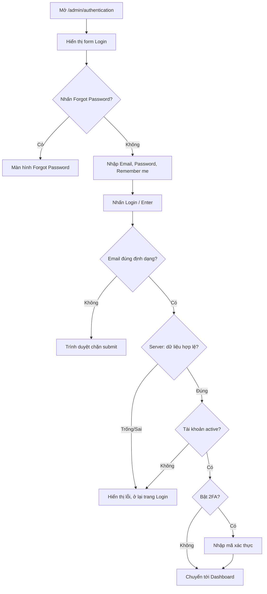

# SOFTWARE REQUIREMENTS SPECIFICATION (SRS)

## Module: Login (Đăng nhập khu vực Admin)

| Thông tin | Nội dung |
|---|---|
| Hệ thống | Perfex CRM – Anh Tester Demo |
| URL module | https://crm.anhtester.com/admin/authentication |
| Module liên quan | Forgot Password – https://crm.anhtester.com/admin/authentication/forgot_password |
| Phiên bản tài liệu | 1.0 (Draft) |
| Ngày lập | 2026-10-09 |
| Nguồn thông tin | Khảo sát giao diện/HTML trang Login và Forgot Password (không đăng nhập) + hành vi chuẩn của Perfex CRM |

> **Quy ước độ tin cậy của từng yêu cầu**
> - **[Quan sát]**: xác nhận trực tiếp từ giao diện / DOM của trang.
> - **[Giả định]**: suy ra từ hành vi chuẩn của Perfex CRM hoặc thông lệ chung, **chưa được xác nhận trên hệ thống** – cần kiểm chứng khi test.
>
> **Phạm vi khảo sát:** Trong lần khảo sát này người thực hiện (AI) **không nhập mật khẩu và không submit form** đăng nhập. Vì vậy các hành vi sau khi submit (thông báo lỗi, màn hình sau đăng nhập, khóa tài khoản…) đều được ghi là [Giả định].

---

## 1. Giới thiệu

### 1.1 Mục đích
Tài liệu mô tả yêu cầu chức năng và phi chức năng của module **Login** trên hệ thống Perfex CRM, làm cơ sở để phân tích, thiết kế test case và kiểm thử thủ công.

### 1.2 Phạm vi
- Màn hình đăng nhập dành cho nhân viên/quản trị (Staff/Admin) tại đường dẫn `/admin/authentication`.
- Liên kết **Forgot Password?** dẫn tới màn hình quên mật khẩu (chỉ mô tả ở mức giao diện và luồng liên quan).
- **Ngoài phạm vi:** đăng nhập cổng khách hàng (Client Portal), đăng ký tài khoản, quản lý nhân viên/phân quyền, nội dung chi tiết màn hình Dashboard.

### 1.3 Đối tượng sử dụng
| Vai trò | Mô tả |
|---|---|
| Admin | Quản trị viên, có toàn quyền hệ thống |
| Staff | Nhân viên có tài khoản trong hệ thống, quyền theo phân quyền |
| Người dùng chưa đăng nhập | Truy cập màn hình Login |

### 1.4 Thuật ngữ
| Thuật ngữ | Giải thích |
|---|---|
| CSRF | Cross-Site Request Forgery – token chống giả mạo request |
| Remember me | Tùy chọn ghi nhớ đăng nhập trên trình duyệt |
| Session | Phiên làm việc sau khi đăng nhập |

### 1.5 Dữ liệu kiểm thử
| Loại | Email | Mật khẩu | Ghi chú |
|---|---|---|---|
| Tài khoản hợp lệ (Admin) | `admin@example.com` | `123456` | Do người yêu cầu cung cấp; đây là tài khoản demo công khai |

---

## 2. Mô tả tổng quan

### 2.1 Bối cảnh
Login là cổng vào bắt buộc của khu vực quản trị (`/admin`). Người dùng chưa xác thực khi truy cập các trang admin sẽ bị chuyển hướng về màn hình này [Giả định].

### 2.2 Giao diện màn hình Login [Quan sát]
- Tiêu đề tab trình duyệt: `Perfex CRM | Anh Tester Demo - Login`.
- Logo "ANH TESTER – Automation Testing" ở đầu trang, là liên kết về trang chủ `https://crm.anhtester.com/`.
- Tiêu đề: **Login**.
- Form nằm trong card ở giữa màn hình, nền xám nhạt.
- Thứ tự các thành phần (từ trên xuống):
  1. Label **Email Address** + ô nhập email
  2. Label **Password** + ô nhập mật khẩu
  3. Checkbox **Remember me**
  4. Nút **Login** (màu xanh, chiếm toàn chiều rộng)
  5. Liên kết **Forgot Password?**
- Ngôn ngữ giao diện: Tiếng Anh (`lang="en"`).

### 2.3 Thông số kỹ thuật của form [Quan sát]
| Thuộc tính | Giá trị |
|---|---|
| Action | `https://crm.anhtester.com/admin/authentication` |
| Method | `POST` |
| Hidden field | `csrf_token_name` (token CSRF, giá trị thay đổi theo phiên) |
| Ô Email | `<input type="email" name="email" id="email">`, **autofocus = true** |
| Ô Password | `<input type="password" name="password" id="password">` |
| Checkbox Remember me | `<input type="checkbox" name="remember" id="remember">`, mặc định **không chọn** |
| Nút Login | `<button type="submit">` |
| Thuộc tính `required` | **Không có** trên cả 2 ô (không dùng validate bắt buộc của HTML5) |
| Thuộc tính `maxlength` | **Không giới hạn** ở phía client |
| Thuộc tính `autocomplete` | Không khai báo |
| Placeholder | Không có |
| `novalidate` của form | Không bật |

> Hệ quả: do không có `required`, trình duyệt sẽ **không** chặn submit khi để trống; việc kiểm tra dữ liệu trống (nếu có) được thực hiện ở phía server. Riêng ô Email có `type="email"` nên trình duyệt vẫn kiểm tra định dạng email cơ bản khi có nhập giá trị.

### 2.4 Giả định và ràng buộc
- Hệ thống chạy trên nền tảng Perfex CRM (CodeIgniter/PHP), kết nối qua HTTPS.
- Dữ liệu tài khoản được lưu ở phía server; mật khẩu được lưu dạng băm [Giả định].
- Đây là môi trường demo công khai nên tài khoản admin có thể bị nhiều người dùng chung, và dữ liệu có thể bị reset định kỳ.

---

## 3. Yêu cầu chức năng

### 3.1 Hiển thị màn hình Login
| ID | Yêu cầu | Độ tin cậy |
|---|---|---|
| FR-LOGIN-01 | Truy cập `/admin/authentication` phải hiển thị màn hình Login gồm: logo, tiêu đề "Login", ô Email Address, ô Password, checkbox Remember me, nút Login, liên kết Forgot Password? | Quan sát |
| FR-LOGIN-02 | Khi trang tải xong, con trỏ tự động đặt vào ô Email Address (autofocus). | Quan sát |
| FR-LOGIN-03 | Ô Password phải che ký tự nhập (dạng `password`). | Quan sát |
| FR-LOGIN-04 | Checkbox Remember me mặc định ở trạng thái không chọn. | Quan sát |
| FR-LOGIN-05 | Click vào logo phải chuyển về trang chủ `https://crm.anhtester.com/`. | Quan sát |
| FR-LOGIN-06 | Click vào label "Email Address", "Password", "Remember me" phải đưa focus/toggle vào control tương ứng. | Giả định |

### 3.2 Đăng nhập
| ID | Yêu cầu | Độ tin cậy |
|---|---|---|
| FR-LOGIN-10 | Người dùng nhập email và mật khẩu hợp lệ rồi nhấn **Login** (hoặc nhấn Enter) → hệ thống xác thực và đăng nhập thành công. | Giả định |
| FR-LOGIN-11 | Sau khi đăng nhập thành công, hệ thống chuyển hướng tới khu vực quản trị (Dashboard, `/admin`). | Giả định |
| FR-LOGIN-12 | Form được gửi bằng phương thức POST kèm CSRF token; request không có token hợp lệ phải bị từ chối. | Quan sát (có token) / Giả định (từ chối) |
| FR-LOGIN-13 | Nhấn phím **Enter** khi đang focus ở ô Email hoặc Password phải submit form giống nhấn nút Login. | Giả định |
| FR-LOGIN-14 | Email không phân biệt chữ hoa/thường khi đăng nhập; mật khẩu **có** phân biệt chữ hoa/thường. | Giả định |
| FR-LOGIN-15 | Khoảng trắng đầu/cuối ở ô Email được loại bỏ (trim) trước khi xác thực. | Giả định |

### 3.3 Xử lý đăng nhập thất bại
| ID | Yêu cầu | Độ tin cậy |
|---|---|---|
| FR-LOGIN-20 | Email đúng định dạng nhưng không tồn tại, hoặc mật khẩu sai → không đăng nhập, ở lại trang Login và hiển thị thông báo lỗi chung (Perfex CRM chuẩn: *"Invalid email or password"*). Thông báo **không** tiết lộ email hay mật khẩu sai. | Giả định |
| FR-LOGIN-21 | Để trống Email và/hoặc Password rồi submit → không đăng nhập, hiển thị thông báo yêu cầu nhập (validate phía server). | Giả định |
| FR-LOGIN-22 | Email sai định dạng (ví dụ `abc`, `abc@`) → trình duyệt chặn submit bằng cảnh báo định dạng email của HTML5. | Quan sát (type=email) |
| FR-LOGIN-23 | Tài khoản bị vô hiệu hóa (inactive) → không đăng nhập, thông báo tài khoản không hoạt động. | Giả định |
| FR-LOGIN-24 | Sau khi đăng nhập thất bại, ô Password phải được xóa trống; ô Email có thể được giữ lại. | Giả định |
| FR-LOGIN-25 | Đăng nhập sai nhiều lần liên tiếp phải kích hoạt cơ chế chống brute-force (giới hạn số lần thử / khóa tạm thời theo IP). Ngưỡng và thời gian khóa cần xác nhận với hệ thống. | Giả định |
| FR-LOGIN-26 | Dữ liệu chứa ký tự đặc biệt / script / SQL (ví dụ `' OR 1=1 --`, `` | Không thực thi script |

---

## 8. Danh sách kịch bản kiểm thử gợi ý (cấp cao)

| ID | Kịch bản | Yêu cầu liên quan |
|---|---|---|
| TS-01 | Hiển thị đầy đủ thành phần màn hình Login | FR-LOGIN-01, UI-LOGIN-01..04 |
| TS-02 | Autofocus vào ô Email khi tải trang | FR-LOGIN-02 |
| TS-03 | Mật khẩu bị che | FR-LOGIN-03 |
| TS-04 | Đăng nhập hợp lệ bằng nút Login | FR-LOGIN-10, 11 |
| TS-05 | Đăng nhập hợp lệ bằng phím Enter | FR-LOGIN-13 |
| TS-06 | Đăng nhập sai mật khẩu | FR-LOGIN-20 |
| TS-07 | Đăng nhập email không tồn tại | FR-LOGIN-20, NFR-SEC-04 |
| TS-08 | Bỏ trống cả hai trường | FR-LOGIN-21 |
| TS-09 | Bỏ trống một trường (Email / Password) | FR-LOGIN-21 |
| TS-10 | Email sai định dạng | FR-LOGIN-22 |
| TS-11 | Email khác hoa/thường | FR-LOGIN-14 |
| TS-12 | Email có khoảng trắng đầu/cuối | FR-LOGIN-15 |
| TS-13 | Remember me – giữ phiên sau khi đóng/mở trình duyệt | FR-LOGIN-30 |
| TS-14 | Không chọn Remember me – phiên kết thúc | FR-LOGIN-31 |
| TS-15 | SQL Injection / XSS ở 2 trường | FR-LOGIN-26, NFR-SEC-06 |
| TS-16 | Đăng nhập sai liên tiếp nhiều lần | FR-LOGIN-25 |
| TS-17 | Click liên kết Forgot Password? | FR-LOGIN-40, 41 |
| TS-18 | Truy cập trang admin khi chưa đăng nhập | FR-LOGIN-50 |
| TS-19 | Truy cập lại trang Login khi đã đăng nhập | FR-LOGIN-51 |
| TS-20 | Logout rồi nhấn Back | FR-LOGIN-52 |
| TS-21 | Tab order và thao tác chỉ bằng bàn phím | UI-LOGIN-02, NFR-USA-01 |
| TS-22 | Responsive trên mobile/tablet | UI-LOGIN-05 |
| TS-23 | CSRF token: gửi request thiếu/sai token | FR-LOGIN-12 |
| TS-24 | Click logo về trang chủ | FR-LOGIN-05 |
| TS-25 | Thời gian tải trang và phản hồi đăng nhập | NFR-PERF-01, 02 |

---

## 9. Vấn đề còn bỏ ngỏ (Open Issues)

| # | Nội dung cần làm rõ |
|---|---|
| 1 | Nội dung chính xác của các thông báo lỗi (sai thông tin, trống, tài khoản inactive, bị khóa). |
| 2 | Ngưỡng và thời gian khóa của cơ chế chống brute-force. |
| 3 | Hệ thống có bật 2FA / reCAPTCHA hay không. |
| 4 | Thời gian sống của session và cookie Remember me. |
| 5 | Trang đích chính xác sau khi đăng nhập (có ghi nhớ trang yêu cầu trước đó hay không). |
| 6 | Quy tắc xử lý khoảng trắng và phân biệt hoa/thường ở email. |
| 7 | Có hiển thị chọn ngôn ngữ trên màn hình Login hay không (hiện chưa thấy). |
| 8 | Môi trường demo có reset dữ liệu/mật khẩu định kỳ hay không. |

---

## 10. Lịch sử thay đổi

| Phiên bản | Ngày | Nội dung |
|---|---|---|
| 1.0 | 2026-10-09 | Tạo bản nháp đầu tiên từ khảo sát giao diện trang Login và Forgot Password |
